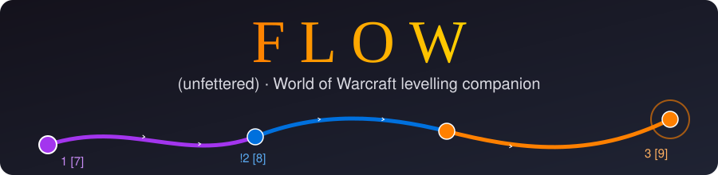

# Flow (unfettered) WoW Mod

A levelling companion addon for **World of Warcraft: Forever**. It suggests what to press, plans
your route, judges your gear, sorts your bags and learns from how you play. It started with the
paladin and is built so other classes can be added without changing existing code.

Flow for WoW is a separate project from Flow Engine.

## Features

### Combat
- **Rotation helper**: an icon shows the spell to press next, and the matching action bar or
  stance bar button glows. The border colour says why: green attack, light blue buff, gold heal,
  fast gold pulse heal now.
- **Cast button and key**: click the icon or press your Flow key to cast the suggestion. Set the
  key in `/flow settings`; it warns you about conflicts and never changes your own key bindings.
  In combat WoW freezes what a key casts, so it keeps the spell from the pull (or Blizzard's
  one-button assistant, if the client has one) and shows it.
- **Smart self-heals**: suggests a heal only when none of it would be wasted by the time the
  cast lands (cast time plus your latency, crits ignored). Suggests an emergency heal when
  you'd die before you could react, unless your target dies first. Silent when the game hides
  your health.
- **Fight types**: boss, several enemies, elite or normal mob, each with its own priorities.
- **Fight profiler**: records every fight and compares your best with your worst per fight
  type. It leans the rotation towards what worked (`/flow fights`).
- **Combat log reports**: `/flow log auto` writes the game's combat log file.
  `tools/analyze-combatlog.ps1` turns it into DPS, healing and tanking reports with
  recommendations, and feeds what it learned back into Flow.

### Questing and navigation
- **Route planner and arrow**: plans the whole trip (quest objectives, turn-ins after their
  objectives, quests to pick up, trainers, and fishing or gathering when it's on the way) and
  points you along it. It learns trails as you walk and follows them around hills and rivers.
- **World map route**: numbered checkpoints with quest levels (`3 [9]`) and quest pickups
  (`!2`). Hover a checkpoint to preview the route that starts there, click it to choose.
- **Party routes**: joining a group asks if you want to follow the party route; your own route
  stays separate (toggle under the arrow). The leader's Flow builds one from the quests you share.
  click and anyone can edit it (choose stops, add waypoints, reach stops). Nobody owns it.
- **Your own waypoint**: Ctrl- or Alt-click the world map, or `/flow way x y`; it clears when you
  arrive.
- **Quest markers on nameplates**: skull with your kill count, diamond with the count of an item
  a mob drops, star for NPCs to talk to; several per mob.
- **Missed quests**: quests you skipped in zones you've quested in (`/flow missed`).
- **Quest reward badges**: the best choice per role (D/H/T), or a gold coin on the best one to
  sell.

### Gear and items
- **Gear scores per role** in every tooltip (red DPS, green Heal, blue Tank), each compared with
  what that item would replace, or with your gear set for that role (Equipment Manager or
  `/flow gear save`).
- **Bag icons**: green arrow to equip now, role dots for other roles, gold coin to sell, AH,
  DE, a quest "!" for items your quests need, and profession icons for crafting materials.
  The tooltip says why.
- **Selling**: at a vendor Flow lists what to sell and sells 12 at a time, which is the size
  of the buyback tab. You can buy any item back with one click, and Flow then never sells it
  again.
- **Skill books**: tells you to hold "+N skill" items until the last points before a cap.

### Progress advice
- **Advice list** (the orange "!" button): spells to train, items to equip, professions behind
  your level, talents, skipped quests, and habits from your best fights. Rows that are places
  route you there.
- **Training and professions**: trainer reminders, profession targets for your level, and spec
  advice (`/flow spec`).

### Quality of life
- A load splash, `/flow help`, `/flow settings`, chat timestamps, and Shift-drag to move any
  Flow element.

## Requirements and companions
- World of Warcraft: Forever (interface 16001).
- Recommended: **Questie** + **QuestieDB**. Flow reads their quest and NPC data at runtime for
  the arrow, map route, missed quests and quest-item keeping. Nothing is copied from them.
- Optional: **Auctionator**, for auction house prices in sell decisions.

## Commands
`/flow help` lists everything. The main ones: `/flow settings`, `/flow rot why`,
`/flow advice`, `/flow way`, `/flow map`, `/flow gear sets`, `/flow sell`, `/flow fights`,
`/flow log auto`, `/flow api`.

## For developers
- `Flow.toc` sets the load order. `Core.lua` holds the event bus and the registries
  (`ns:Register` / `ns:Get` / `ns:Each`).
- `Modules/` holds the features. `Classes/<Class>/` holds class data, trainer spells and the
  rotation.
- [docs/ARCHITECTURE.md](docs/ARCHITECTURE.md) lists every extension point and how to add a
  class; [docs/GEAR_PLAN.md](docs/GEAR_PLAN.md) covers gear scoring.
- **No Lua interpreter here:** test in game with `/console scriptErrors 1`, and use
  `/flow rot why` and `/flow api` when debugging.
- **Dev install:** the game's `Interface\AddOns\Flow` is a junction to this repo, so `/reload`
  picks up changes.
- **Packaging:** `tools/package.ps1` builds a release zip; see [docs/PUBLISHING.md](docs/PUBLISHING.md).
